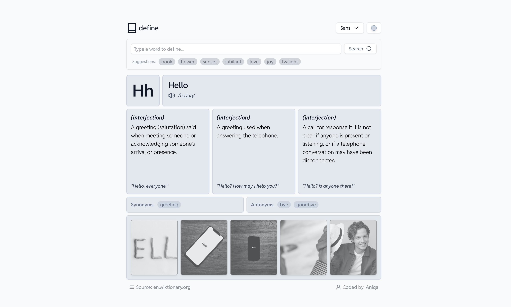
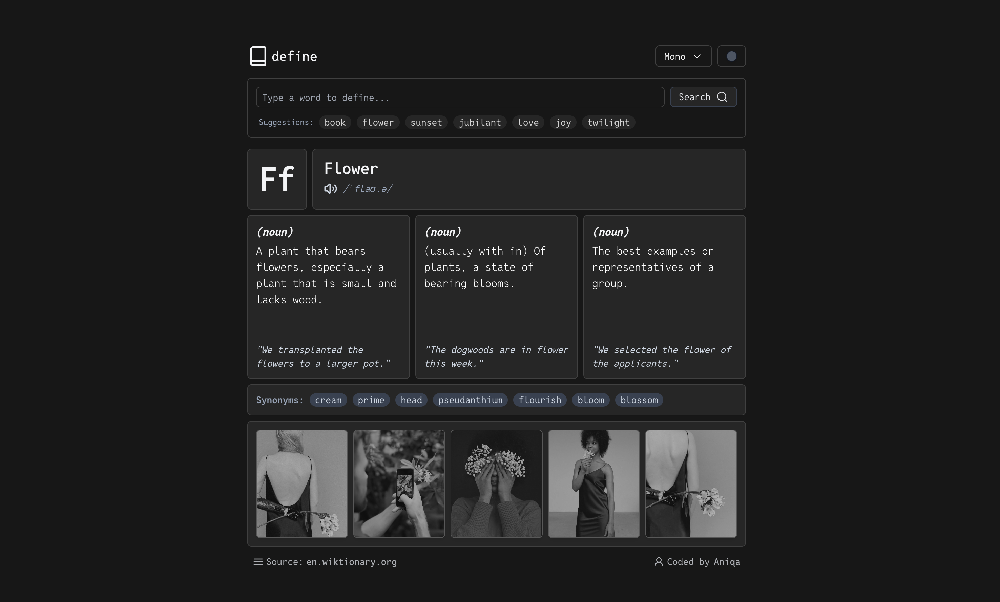
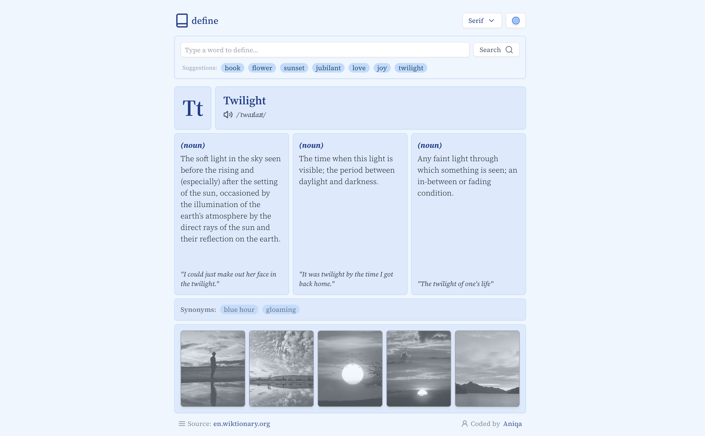
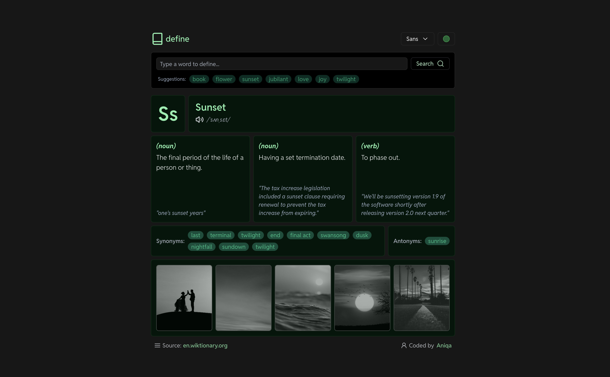

# define

A dictionary app that shows a word's definitions, examples, pronunciation, related words and photos, in four themes and three typefaces.

**[Live site](https://define.aniqa.dev)**

<table>
  <tr>
    <td width="50%"><a href="https://define.aniqa.dev"></a></td>
    <td width="50%"><a href="https://define.aniqa.dev"></a></td>
  </tr>
  <tr>
    <td><a href="https://define.aniqa.dev"></a></td>
    <td><a href="https://define.aniqa.dev"></a></td>
  </tr>
</table>

## Tech

- React 19, bootstrapped with Create React App
- Tailwind CSS, with custom variants for each theme
- Framer Motion for the entrance animations
- Radix UI Select for the theme and font menus, and Lucide icons
- Free Dictionary API for definitions, and the SheCodes Images API for photos

## Features

- Definitions grouped by part of speech, with examples
- Pronunciation text and an audio button when the dictionary has a recording
- Synonyms and antonyms you can click to look up next
- Up to five photos of the word, each linking to its source
- Suggested words to try (zephyr, ethereal, twilight and more)
- Light, dark, ocean and forest themes, and sans, serif or mono type
- Remembers your last word, theme and font, starting with "hello"
- Clear error messages when a word isn't found

## Design

- A grid of cards, led by a large first letter of the word
- Cards appear in sequence, and the grid and footer animate together with `AnimatePresence`

## Accessibility

- The theme and font menus use Radix Select, so they work with the keyboard and screen readers
- Photos use their descriptions as alt text

## Project structure

- `src/components/header/`: logo and the theme and font menus
- `src/components/search/`: search input and suggested words
- `src/components/grid/`: the word, letter, definitions, related words and photo cards
- `src/context/`: theme and font providers
- `src/data/api.js`: dictionary and image requests

## Key concepts

- **Context API for settings.** Theme and font live in their own contexts, so any card can read them without passing props down.
- **Custom Tailwind variants** (`dark:`, `ocean:`, `forest:`) let each theme be styled right next to the default.
- **Sequenced animation.** Framer Motion variants stagger the cards, so a new word builds in rather than popping in all at once.
- **A SheCodes project, extended.** The course provided the image API; the themes, fonts, related-word lookups and layout are my own.

## Setup

Requires Node 18+ and a SheCodes API key for images. Definitions need no key.

| Variable | Where to get it |
| --- | --- |
| `REACT_APP_API_KEY` | Your SheCodes account |

```bash
git clone https://github.com/aniqatc/define.git
cd define
npm install
echo "REACT_APP_API_KEY=your_key" > .env
npm start
```

## Scripts

| Command | What it does |
| --- | --- |
| `npm start` | Dev server at http://localhost:3000 |
| `npm run build` | Production build in `build/` |
| `npm run format` | Prettier |

## Changelog

### January 2025

- Initial release
